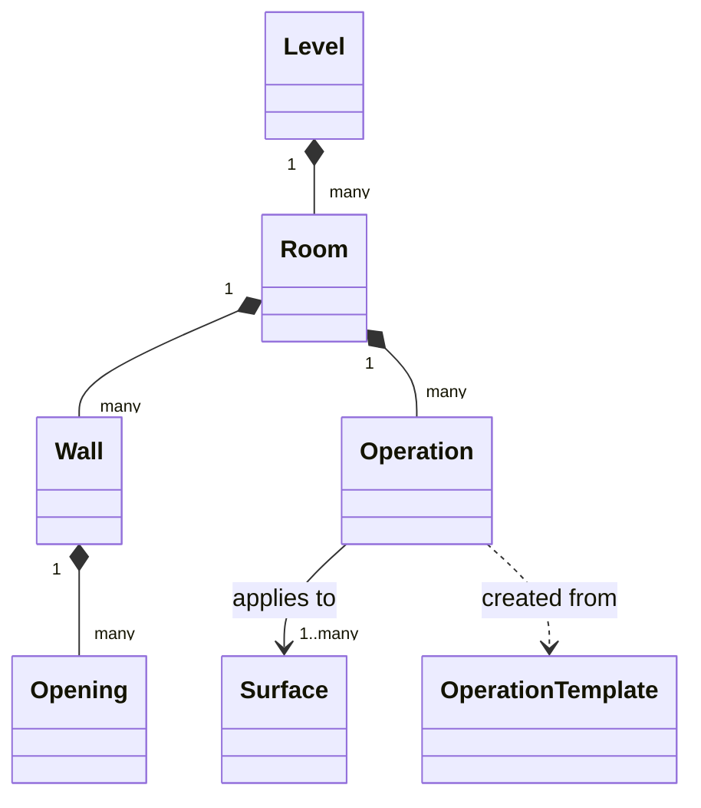

# 02 – Domain model

All entities have a stable `id: Uuid` generated on the device, so that data can later be synced
without ID collisions (see [ADR 0003](adr/0003-uuid-ids-and-repository-interfaces.md)).

Lengths are stored as integer **millimetres** (see [ADR 0002](adr/0002-lengths-in-millimetres.md)).



## Level

| Field | Type | Notes |
|---|---|---|
| id | Uuid | |
| name | String | e.g. "Ground floor" |
| rooms | List<Room> | ordered |

## Room

| Field | Type | Notes |
|---|---|---|
| id | Uuid | |
| name | String | e.g. "Bathroom" |
| height | Millimetres | floor to ceiling |
| walls | List<Wall> | in outline order, numbered from 1 |
| shapeInput | `Rectangle` \| `Outline` | how the user entered the shape (editor mode only; geometry always comes from `walls`) |

A rectangle is just a convenience: `Rectangle(length, width)` generates four walls
`length, R, width, R, length, R, width, R`.

## Wall

| Field | Type | Notes |
|---|---|---|
| number | Int | 1..n, position in the outline |
| length | Millimetres | |
| turn | `LEFT` \| `RIGHT` | direction of the 90° turn at the end of this wall |
| openings | List<Opening> | |
| name | String? | optional label to recognise the wall, e.g. "Zlew", "Telewizor"; kept by wall number when the shape changes |

## Opening

| Field | Type | Notes |
|---|---|---|
| id | Uuid | |
| type | `WINDOW` \| `DOOR` \| `PASSAGE` \| `NICHE` | label for summaries; sets the default of `startsAtFloor` |
| size | `Dimensions(width, height)` \| `Area(m²)` | |
| startsAtFloor | Boolean | default: true for DOOR and PASSAGE, false otherwise |

Rule: an opening that starts at the floor **must** be given as `Dimensions`, because its width is
needed to shorten the skirting.

## Surface

Where an operation is applied:

```kotlin
sealed interface Surface {
    data class Wall(val number: Int) : Surface
    data object Floor : Surface
    data object Ceiling : Surface
    data object Skirting : Surface       // linear, metres
    data object CrownMoulding : Surface  // linear, metres
    data class Custom(val quantity: Double, val unit: MeasureUnit) : Surface  // typed by the user
}
```

## Operation, OperationTemplate

Described in [04 – Operations and costs](04-operations-and-costs.md).
