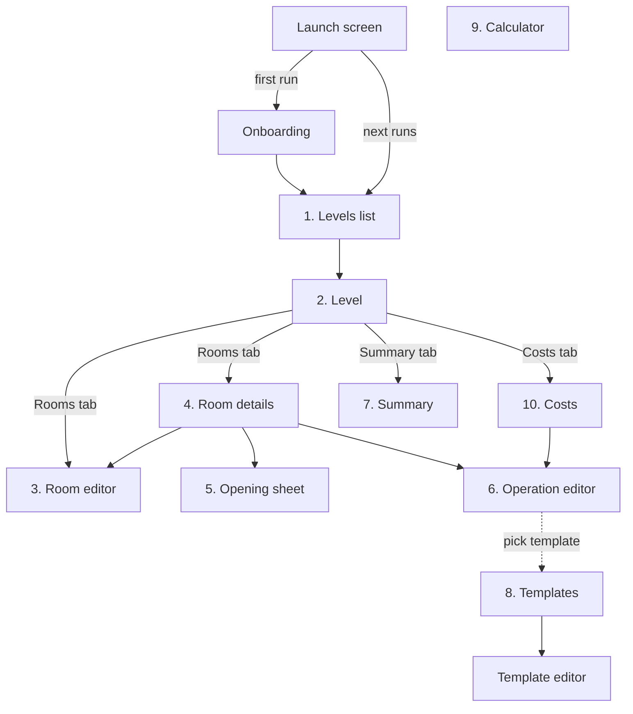

# 06 – Screens

MVP screens, how the user moves between them and what each one offers.
UI texts are in Polish (see [glossary](glossary.md)); this document uses English names.

## Navigation

A bottom bar with three destinations:

| Tab | Start screen |
|---|---|
| **Project** | Levels list |
| **Templates** | Operation templates |
| **Calculator** | Price-per-m² calculator |

Every derived number (areas, lengths, costs) is recalculated live on every screen; nothing needs a
"recalculate" button.

## Launch screen

- Native splash, not a Compose screen: Android SplashScreen API, iOS launch screen in `Info.plist`.
- App icon on the brand background colour; shown only while the app and database start.
- Routes to **Onboarding** on the first run, otherwise to **Levels list**.
- As built: the white app glyph (a floor plan with a notched corner under a dimension line) on the
  brand terracotta, the same artwork as the app icon. Android uses `Theme.RenoPlan.Starting`
  (`androidApp/src/main/res/values/themes.xml`); iOS uses `UILaunchScreen` in `Info.plist` with the
  `LaunchBackground` colour and `LaunchLogo` image assets. Until Onboarding exists, the app always
  opens on the Levels list.
- Icon and launch logo PNGs are generated by `swift scripts/render-icons.swift .`; the Android vector
  `ic_launcher_foreground.xml` holds the same geometry, so change both together.

## Onboarding

Shown once on the first run; skippable at any time. Can be reopened from the help icon on the
Levels list.

1. **Plan your renovation** – what the app does: rooms, areas, work and costs in one place.
2. **Measure rooms** – rectangle or outline, walls are numbered; openings are subtracted.
3. **Add work and prices** – operations on walls, floor and ceiling; material and labour prices.
4. **Track costs and progress** – summary per room or level; mark work as done.

Last page: **Create your first level** (asks for a name, opens the Level) or **Skip**.
A "seen" flag is stored locally so onboarding does not show again.

## 1. Levels list

Home screen of the Project tab.

- Card per level: name, number of rooms, total floor area, total cost, progress (% of cost done).
  Cost and progress appear once the level has operations; room cards on the Level screen show the same.
- **Add level** (FAB): asks for a name.
- Card menu: rename, delete (with confirmation).
- Empty state: short explanation and an "Add your first level" button.
- Top bar: help icon → Onboarding.
- Tap a card → **Level**.

## 2. Level

Three tabs: **Rooms**, **Summary** (quantities, screen 7) and **Costs** (money, screen 10). The tab row
scrolls when the labels do not fit (large system font), so labels never wrap.

Rooms tab:

- Card per room: name, floor area, net wall area, cost, progress.
- **Add room** (FAB) → **Room editor** (new room).
- Card menu: rename, duplicate (copies geometry, openings and operations), delete.
- Tap a card → **Room details**.

## 3. Room editor

Creating a room or changing its geometry.

- Name, height.
- Shape mode toggle: **Rectangle** / **Outline**.
  - Rectangle: length, width.
  - Outline: list of rows `#, length, turn (L/R)`; add / remove row; "close automatically" option
    computes the last wall ([03 – Calculations](03-calculations.md#auto-closing-the-last-wall)).
    Turning it on adds the computed wall after the typed rows; if the typed rows already close the
    outline, their last row is replaced by the computed wall. Turning it off keeps the computed wall
    as an editable row.
- Read-only **preview** of the outline with wall numbers, so the user can match numbers to real walls.
  The start point is marked with a dot; an outline that does not close shows the gap.
- Live results: floor area, perimeter, volume.
- Validation message when the outline does not close (distance to the start point, or wrong turn
  count); shown once every wall has a valid length. **Save** is disabled until it closes.
- Switching Rectangle → Outline converts the 4 walls into rows; Outline → Rectangle is only allowed
  for a 4-wall outline.
- Lengths are typed in metres with a comma or a dot (e.g. `2,65`) and stored as millimetres. A field
  shows an error only once something invalid has been typed into it; Save stays disabled until the
  name and every length are valid.

Changing geometry keeps openings and operations. If a wall number disappears (fewer walls), the user
is warned which openings and operations will lose that wall.

## 4. Room details

The main working screen of a room.

- Header: floor, ceiling, net walls, perimeter, skirting, volume. Button **Edit shape** → Room editor.
  Button **Room summary** → the Summary filtered to this room (screen 7).
- **Walls** section: row per wall `Wall 1 – 3.20 m – 7.20 m² net – 2 openings`; tap a wall to see its
  openings (tap an opening to edit it); **Add opening** → Opening sheet; **Name the wall** gives it a
  label such as "Zlew" or "Szafa" (empty removes it). A named wall shows as "Wall 1 · Zlew" here, in
  the Operation editor's surface chips and in the Opening sheet's wall picker. The floating **Add opening**
  button preselects the expanded wall, or wall 1.
- **Operations** section: row per operation with type, surfaces, quantity, cost and status chip;
  tap the status chip to cycle *to do → in progress → done*; **Add operation** → Operation editor.
- Room totals: cost, done, remaining.
- Room totals sit above the operations list, with a progress bar (done ÷ total cost).

## 5. Opening sheet

Bottom sheet for adding or editing an opening.

- Type: window / door / passage / niche.
- Wall: number picker (preselected when opened from a wall).
- Size: toggle **Dimensions** (width, height) / **Area** (m²).
- **Starts at floor** switch, default from type (changing the type resets it); when on, Dimensions mode
  is required and Area is disabled.
- Live result: opening area, the wall's net area after the change.
- Validation from [03](03-calculations.md#openings): wider than the wall, taller than the room, or
  openings larger than the wall; **Save** is disabled while any of them applies. Changing the wall
  moves the opening.
- Delete (when editing).

## 6. Operation editor

- **Type**: list of types; Painting asks for a colour, Custom asks for a name.
  Or **From template** → picks a template and prefills everything below.
- **Surfaces**: multi-select chips `Wall 1 … Wall n`, `All walls`, `Floor`, `Ceiling`, `Skirting`,
  `Crown moulding`. Wall surfaces and linear surfaces cannot be mixed in one operation (different units).
- Live quantity (m² or m).
- **Material price** per unit.
- **Labour**: segmented control *per unit / lump sum / I do it myself*, with the price field
  where it applies.
- **Status**: to do / in progress / done.
- Live cost: material, labour, total.
- **Save as template** checkbox.
- Templates, when there are any, are offered as chips at the top; picking one fills the type and
  prices.
- Prices are typed in złoty; a blank price counts as 0 zł.
- Choosing Skirting or Crown moulding as the type selects that surface, replacing an area selection or
  the other moulding; mouldings chosen by hand are kept. Leaving a moulding type clears the moulding it
  selected. Selecting a surface of the other unit (m² vs m) starts a new selection instead of mixing
  them.
- **Show the room's walls** toggles the outline preview with wall numbers, to match numbers to walls.
- The quantity is **either** computed from surfaces (**From surfaces**: wall, floor, ceiling and
  moulding chips) **or** typed (**Custom quantity**: e.g. half a wall or crown moulding on one wall,
  in m² or m; a moulding type picks m). A toggle chooses; only the chosen one counts.
- **Delete** (with confirmation) in the top bar when editing.

## 7. Summary

Quantities only: how much of what. Shown as the Summary tab of a Level (and as a filtered view for a
single room from Room details).

- Toggle **By room** / **Whole level**.
- Geometry block: total floor, ceiling and net wall area, skirting and crown moulding length.
- Table grouped by operation type (with colour for painting): surfaces, quantity, status counts.
  - By room: one group per room.
  - Whole level: one row per type, e.g. "Skim coat – 10 walls – 100.00 m²".
- A group is one operation type and unit: painting is grouped per colour, custom work per name.
  Mouldings count the rooms they are in ("skirting in 4 rooms").
- The single-room view opens from **Room summary** in Room details: the same geometry block and
  groups, for that room only.

## 8. Templates

- List of templates: type, material price, labour (prices per unit of the operation).
- Add (FAB) / edit (tap a template) / delete (in the editor, with confirmation). The editor is the
  Operation editor without surfaces and status.
- Editing a template does not change operations created from it earlier
  ([04](04-operations-and-costs.md#templates)).

## 9. Calculator

- Toggle **Per m²** / **Per metre**.
- Per m² inputs: package price, package amount, unit (L / kg), coverage (m² per unit), coats (default 2).
- Per metre inputs: package price and metres in the package; result: price per metre.
- Results: area per package, **price per m²**, and the 1-coat price for reference.
- Copy-to-clipboard button for the result; the user enters it into an operation manually.
  It copies the bare amount (e.g. `11,43`) and confirms with a snackbar.
- Unit toggle above the amount; the amount and coverage suffixes follow it (`L`, `m²/L`).
- Results appear once every field is valid; a field shows an error only after something invalid has
  been typed. Nothing is saved: the form resets when the app restarts.

## 10. Costs

Money: what it costs and how prices are set. Costs tab of a Level.

- Header: total cost, done, remaining, progress bar; split into material and labour.
- Toggle **By room** / **By operation type**.
- Under each room or type heading (with its total), one row per operation: quantity, material price,
  labour (per unit / lump sum / self), cost, status. Tap a row → **Operation editor**.
- **Edit price for all**: on a type group (e.g. "Painting – white"), set material price and labour once
  and apply them to every operation of that type on the level. Shows how many operations will change
  and the cost before → after.
- Toggle labour **I do it myself** for a whole group, to see quickly how much doing it yourself saves.
- Both live in the menu (⋮) of a type group in the **By operation type** view. *I do it myself* asks
  for confirmation, showing the saving, and keeps material prices; to bring labour back, use
  *Edit price for all*. Both change the stored operations, not just the view.
- Levels list cards show each level's total, so the cost of the whole apartment is visible on the
  home screen.

## Implementation order

Follows the [roadmap](01-scope.md#roadmap):

1. Launch screen, Levels list, Level (Rooms tab), Room editor – rectangle mode.
2. Room editor – outline mode with preview; Room details – walls and openings.
3. Operation editor, Room details – operations, Summary, Costs, Templates.
4. Statuses and progress, Calculator, Onboarding (last, when the screens it describes are stable).

## Accessibility

- Text sizes are in `sp`, so they follow the system font size on Android and iOS; layouts wrap or
  scroll instead of clipping, and labels are not shrunk to fit.
- Icons that act on their own have a content description; decorative ones next to a label do not.
- Toggles are whole rows (switch, checkbox) so the label is part of the touch target.
- While the keyboard is open, a **Done** bar sits on top of it in every editor, the calculator and the
  opening sheet; it closes the keyboard (the iOS number pad has no return key).
- Tapping outside a field or dragging the content with a finger hides the keyboard on every screen and in the
  opening sheet; the iOS number pad has no key to close it.
- Operation statuses differ by icon and colour (to do: empty circle, grey; in progress: half circle,
  yellow; done: check mark, green), so colour is never the only cue.

## Out of scope for the MVP

Settings (currency, units are fixed to PLN and metres), export/share, dark/light theme
switch beyond the system setting.
