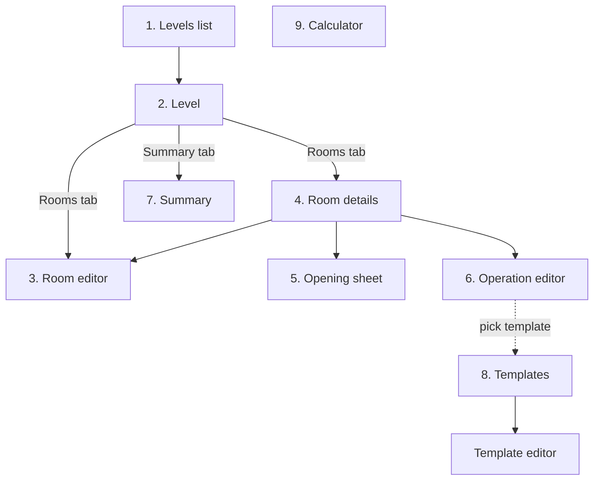

# 06 – Screens

MVP screens, how the user moves between them and what each one offers.
UI texts are in Polish (see [glossary](glossary.md)); this document uses English names.

## Navigation

A bottom bar with three destinations:

| Tab | Start screen |
|---|---|
| **Project** | Levels list |
| **Templates** | Operation templates |
| **Calculator** | Price-per-m² calculator |

Every derived number (areas, lengths, costs) is recalculated live on every screen; nothing needs a
"recalculate" button.

## 1. Levels list

Home screen of the Project tab.

- Card per level: name, number of rooms, total floor area, total cost, progress (% of cost done).
- **Add level** (FAB): asks for a name.
- Card menu: rename, delete (with confirmation).
- Empty state: short explanation and an "Add your first level" button.
- Tap a card → **Level**.

## 2. Level

Two tabs: **Rooms** and **Summary** (see screen 7).

Rooms tab:

- Card per room: name, floor area, net wall area, cost, progress.
- **Add room** (FAB) → **Room editor** (new room).
- Card menu: rename, duplicate (copies geometry, openings and operations), delete.
- Tap a card → **Room details**.

## 3. Room editor

Creating a room or changing its geometry.

- Name, height.
- Shape mode toggle: **Rectangle** / **Outline**.
  - Rectangle: length, width.
  - Outline: list of rows `#, length, turn (L/R)`; add / remove row; "close automatically" option
    computes the last wall ([03 – Calculations](03-calculations.md#auto-closing-the-last-wall)).
- Read-only **preview** of the outline with wall numbers, so the user can match numbers to real walls.
- Live results: floor area, perimeter, volume.
- Validation message when the outline does not close; **Save** is disabled until it does.
- Switching Rectangle → Outline converts the 4 walls into rows; Outline → Rectangle is only allowed
  for a 4-wall outline.

Changing geometry keeps openings and operations. If a wall number disappears (fewer walls), the user
is warned which openings and operations will lose that wall.

## 4. Room details

The main working screen of a room.

- Header: floor, ceiling, net walls, perimeter, skirting, volume. Button **Edit shape** → Room editor.
- **Walls** section: row per wall `Wall 1 – 3.20 m – 7.20 m² net – 2 openings`; tap a wall to see its
  openings; **Add opening** → Opening sheet.
- **Operations** section: row per operation with type, surfaces, quantity, cost and status chip;
  tap the status chip to cycle *to do → in progress → done*; **Add operation** → Operation editor.
- Room totals: cost, done, remaining.

## 5. Opening sheet

Bottom sheet for adding or editing an opening.

- Type: window / door / passage / niche.
- Wall: number picker (preselected when opened from a wall).
- Size: toggle **Dimensions** (width, height) / **Area** (m²).
- **Starts at floor** switch, default from type; when on, Dimensions mode is required.
- Live result: opening area, the wall's net area after the change.
- Delete (when editing).

## 6. Operation editor

- **Type**: list of types; Painting asks for a colour, Custom asks for a name.
  Or **From template** → picks a template and prefills everything below.
- **Surfaces**: multi-select chips `Wall 1 … Wall n`, `All walls`, `Floor`, `Ceiling`, `Skirting`,
  `Crown moulding`. Wall surfaces and linear surfaces cannot be mixed in one operation (different units).
- Live quantity (m² or m).
- **Material price** per unit.
- **Labour**: segmented control *per unit / lump sum / I do it myself*, with the price field
  where it applies.
- **Status**: to do / in progress / done.
- Live cost: material, labour, total.
- **Save as template** checkbox.

## 7. Summary

Shown as the Summary tab of a Level (and as a filtered view for a single room from Room details).

- Toggle **By room** / **Whole level**.
- Geometry block: total floor, ceiling and net wall area, skirting and crown moulding length.
- Table grouped by operation type (with colour for painting): surfaces, quantity, cost, done, remaining.
  - By room: one group per room.
  - Whole level: one row per type, e.g. "Skim coat – 10 walls – 100.00 m²".
- Totals: cost, done, remaining, progress bar.

## 8. Templates

- List of templates: type, material price, labour.
- Add / edit / delete. The editor is the Operation editor without surfaces and status.
- Editing a template does not change operations created from it earlier
  ([04](04-operations-and-costs.md#templates)).

## 9. Calculator

- Inputs: package price, package amount, unit (L / kg), coverage (m² per unit), coats (default 2).
- Results: area per package, **price per m²**, and the 1-coat price for reference.
- Copy-to-clipboard button for the result; the user enters it into an operation manually.

## Implementation order

Follows the [roadmap](01-scope.md#roadmap):

1. Levels list, Level (Rooms tab), Room editor – rectangle mode.
2. Room editor – outline mode with preview; Room details – walls and openings.
3. Operation editor, Room details – operations, Summary, Templates.
4. Statuses and progress, Calculator.

## Out of scope for the MVP

Settings (currency, units are fixed to PLN and metres), onboarding, export/share, dark/light theme
switch beyond the system setting.
